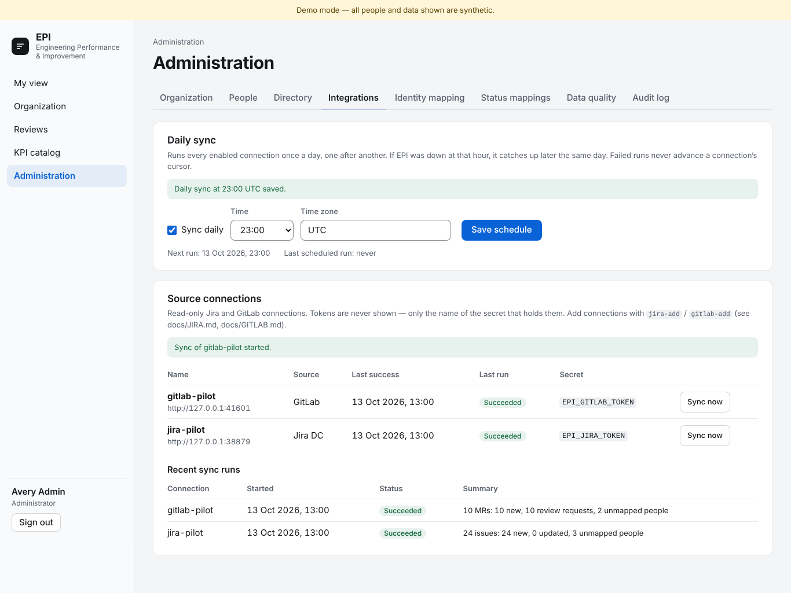
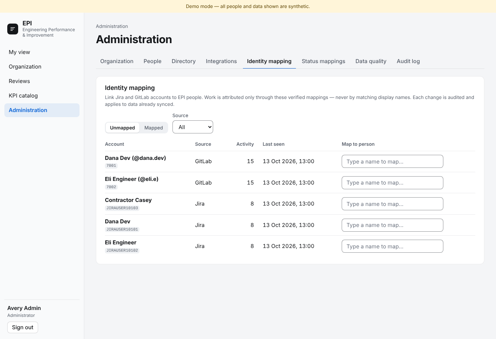
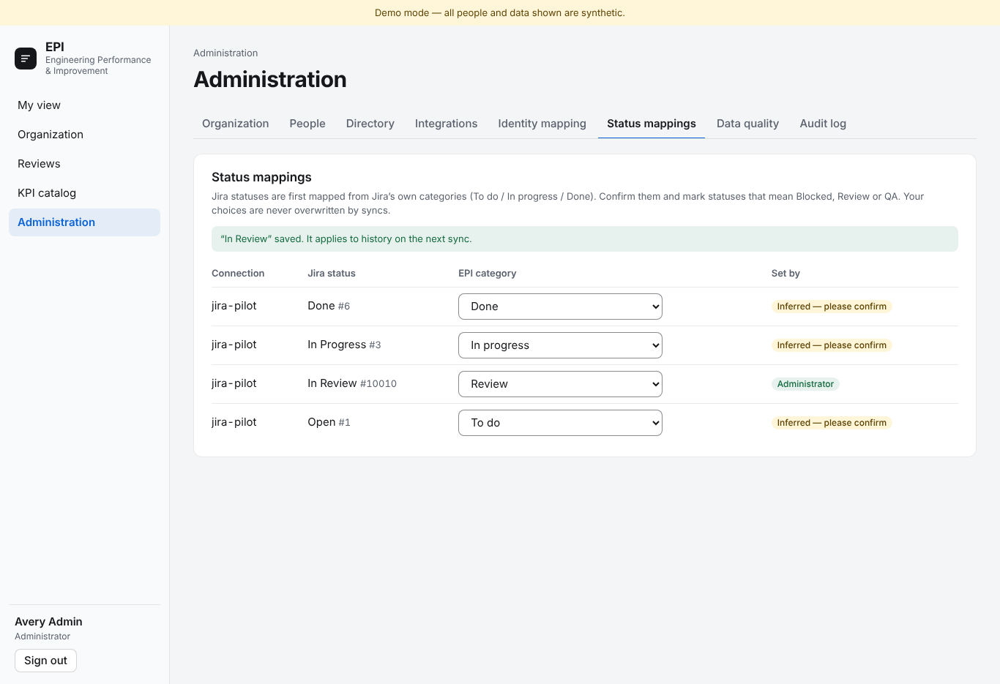
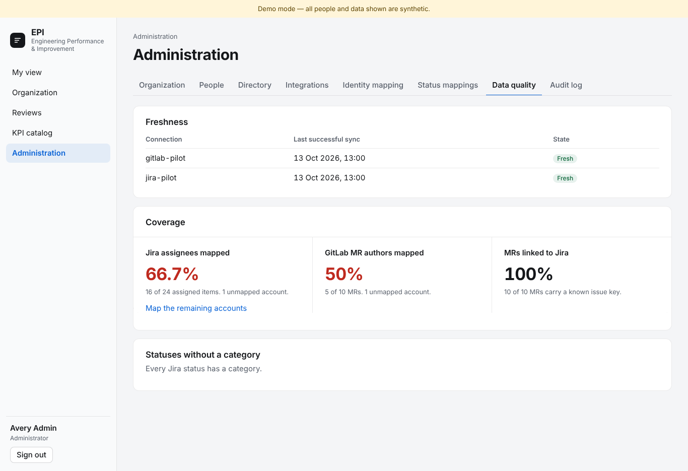
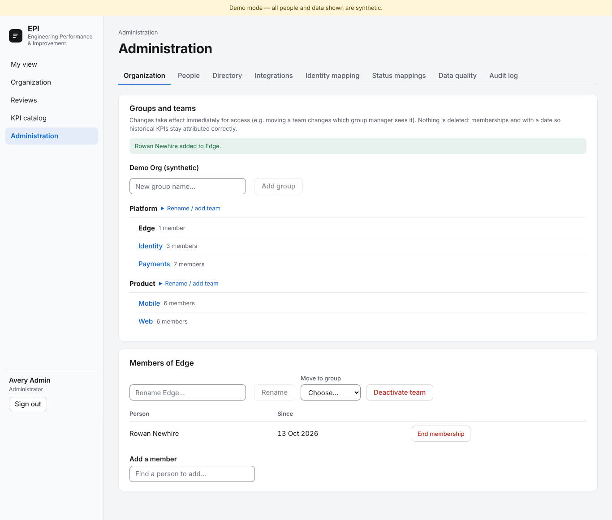
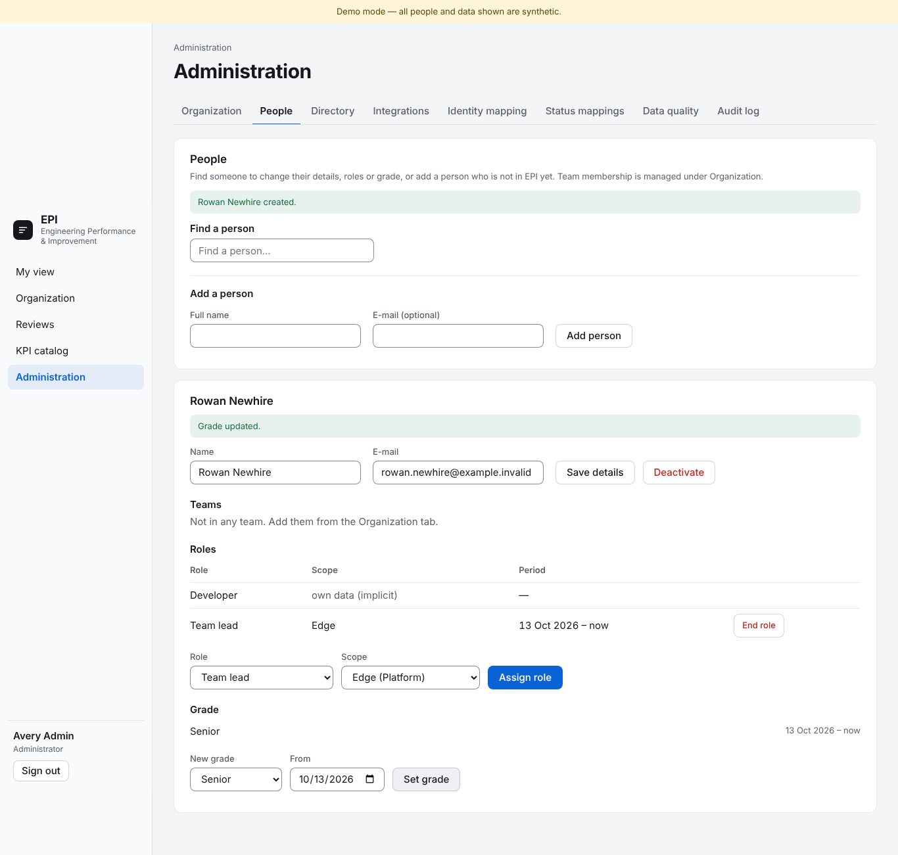
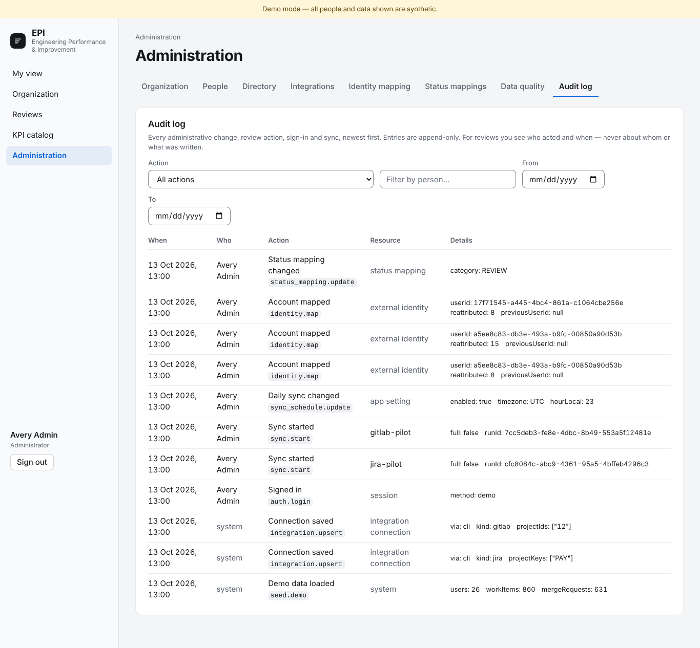
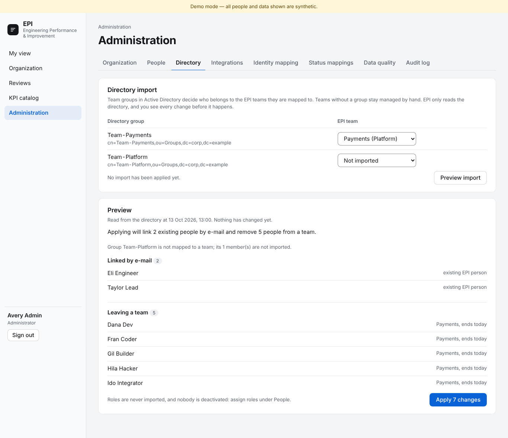

# EPI screenshots

Captured 2026-10-12, refreshed 2026-10-13 after the UI/UX pass (UX-01), from `./epi.sh demo` (Docker Compose, bundled demo Keycloak) with Playwright/Chromium. **All people and data are synthetic.** Regenerate after UI changes (see “How these were made” below).

## Sign-in

### Sign-in page: single sign-on, demo people grouped by role (synthetic)

### Keycloak login page (demo realm epi-demo)

### Team lead home: assessments to write this month, team overview, own KPIs

### Sign-in refused (no EPI account): clear message, no auto-provisioning

## Role-based home pages

### Engineering manager home: organization KPIs and teams

### Developer home: own flow KPIs and team aggregate (no member-level evidence)

### Privacy: team aggregate hidden for a 3-person team (minimum 5)

### Administrator: organization structure only — no KPIs or private reviews

## Drill-down: organization → group → team → developer

### Organization → group → team tree with access badges

### Group overview: group KPIs and its teams (alphabetical, never ranked)

### Team overview (managed): KPI strip with trend, sample, confidence and freshness; members

### Developer profile (manager view): grade, team, flow KPIs with neutral trends, assessments

### Out-of-scope team opened by URL: “Not available” (server returns 404)

## Explainable KPIs

### Switching the KPI window (30/90/180 days; kept in the URL)

### "How calculated?" sheet: formula, population, source, window, version, exclusions

### Sheet continued: limitations, worked example computed by the engine, items behind the value

### KPI catalog: versioned definitions, units, direction, scopes

## Monthly assessments

### Monthly manager assessment: anchored 1–5 rubrics with required evidence

### After submitting: lasting confirmation; the assessment is locked for the month

### Reviews: the developer sees submitted assessments about themselves

## Responsive, dark mode and API

### Dark mode (follows the operating system setting)

### Phone layout: home

### Phone layout: team KPIs

### OpenAPI / Swagger UI at /api/docs

## Administration (identity mapping and data quality)

Captured by `scripts/e2e-admin.sh --screenshots`: EPI synced against in-process fake Jira DC and GitLab servers (synthetic data).

### Administration › Integrations: Jira/GitLab connections, Sync now, recent runs (fake sources, synthetic data)

### Administration › Identity mapping: accounts seen in syncs, mapped to EPI people by search

### Administration › Status mappings: Jira status → EPI category, inferred vs admin-confirmed

### Administration › Data quality: freshness, identity coverage, MR-to-Jira links, unmapped statuses

### Administration › Organization: groups and teams, members with dates, add/transfer and end memberships

### Administration › People: create a person, assign roles on a scope, grade history

### Administration › Audit log: who changed what and when, filterable; review subjects and text never shown

### Administration › Directory: AD team groups mapped to EPI teams, preview of every change before applying (synthetic directory)

## How these were made

1. `./epi.sh demo` (synthetic people only).
2. `EPI_DOC_SHOTS=1 npx playwright test e2e/doc-screenshots.spec.ts --project=desktop` signs in as each demo role, visits every screen at 1366×900, in dark mode and at phone width (390×844), saves the PNGs here and rewrites `screenshots/index.json` (file → caption). It submits one synthetic assessment for the demo person Dana Dev; re-runs find it already submitted.
3. Admin shots (25–32) come from `scripts/e2e-admin.sh --screenshots` (fake Jira/GitLab, synthetic LDAPS directory).
4. The Keycloak page (02) is Keycloak's own, captured before any password is typed; no password appears in any screenshot.
